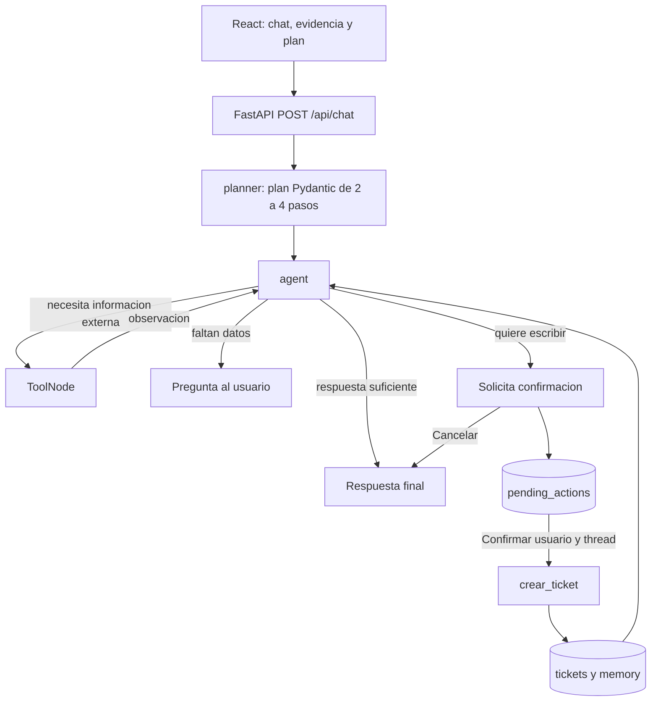

# Ragzor Assistant

Ragzor es un asistente de Mesa de Ayuda TI. La EP1 respondia con un LLM y RAG;
la EP2 conserva ese trabajo y lo convierte en **un unico agente** capaz de
planificar, elegir tools, observar resultados, recordar contexto y solicitar
confirmacion antes de escribir un ticket.

## Evolucion EP1 → EP2

| Etapa | Capacidades |
|---|---|
| Ragzor EP1 | React + FastAPI + Ollama + RAG (bge-m3, FAISS, top 2 chunks) |
| Ragzor EP2 | EP1 + LangGraph + planner + 3 tools + memoria corta/larga + confirmacion humana |

No se reemplazo el RAG: ahora esta encapsulado en `buscar_documentacion` y el
agente decide cuando usarlo.

## Arquitectura



Flujo principal: `React → FastAPI → LangGraph → planner → agent → tool → agent`.

## Las tres tools

1. `buscar_documentacion(query)`: reutiliza bge-m3, FAISS y el retriever EP1;
   devuelve los dos chunks mas cercanos y metadata para "Ver evidencia".
2. `consultar_ticket(ticket_id, user_id)`: consulta SQLite sin modificar datos.
3. `crear_ticket(action_id, thread_id, user_id)`: consume una propuesta
   persistida y crea como maximo un ticket. No recibe resumen ni detalles desde
   el LLM durante la confirmacion.

## Memoria y seguridad

- **Corto plazo:** `MemorySaver` conserva mensajes por la clave compuesta
  `user_id:thread_id`; no persiste tras reiniciar el backend.
- **Largo plazo:** `memory` mantiene el ultimo ticket y resumen; `tickets`
  conserva varias solicitudes y permite listarlas sin confundir IDs.
- **Recuperacion semantica:** corresponde al corpus documental FAISS con
  `bge-m3`; consultar tickets SQLite no se presenta como memoria semantica.
- **Confirmacion:** `pending_actions` guarda una propuesta inmutable con UUID,
  propietario, thread, estado y expiracion. Confirmar la consume dentro de la
  misma transaccion que crea el ticket; los reintentos devuelven el mismo ID.
- **Replanificacion:** el planner se ejecuta en cada turno, compara el plan
  anterior y registra el cambio en `activity`. Un cambio de objetivo habilita
  una nueva consulta documental.

El LLM sigue siendo `llama3:latest`. Como el cliente Ollama original no expone
tool calling nativo, planner y agente devuelven JSON validado con Pydantic;
LangGraph convierte la accion validada en llamadas reales de `ToolNode`. No se
muestra razonamiento interno.

## Requisitos e instalacion

- Python 3.11+
- Node.js 18+
- Ollama

```bash
python3 -m venv .venv
source .venv/bin/activate
pip install -r backend/requirements.txt
npm --prefix frontend install
cp .env.example .env
ollama pull llama3
ollama pull bge-m3
```

## Preparar datos

Crear o actualizar el indice documental FAISS:

```bash
python scripts/ingest.py
```

Crear `ragzor.db` y tickets sinteticos para la demostracion:

```bash
python scripts/seed_database.py
```

SQLite crea `tickets`, `memory` y la tabla de control `pending_actions`.
El esquema se crea de forma compatible con bases existentes.

## Ejecutar

Terminal 1:

```bash
ollama serve
uvicorn app.main:app --app-dir backend --reload --host 127.0.0.1 --port 8000
```

Terminal 2:

```bash
npm --prefix frontend run dev
```

Abrir `http://127.0.0.1:5173`. Tambien se puede usar `docker compose up --build`.

## API

`POST /api/chat`

```json
{
  "message": "Necesito acceso administrador a produccion por dos semanas",
  "thread_id": "demo-thread-1",
  "user_id": "ana"
}
```

Respuesta resumida:

```json
{
  "answer": "¿Cual es el servidor exacto y la justificacion?",
  "thread_id": "demo-thread-1",
  "plan": ["Consultar politicas.", "Revisar datos faltantes."],
  "sources": [],
  "needs_confirmation": false,
  "pending_action": null,
  "activity": ["Consulto documentacion."]
}
```

Para confirmar, el mismo thread envia:

```json
{
  "message": "Confirmar ticket",
  "thread_id": "demo-thread-1",
  "user_id": "ana",
  "confirmation": "confirm"
}
```

## Estado LangGraph

El estado se mantiene pequeño: `messages`, `user_id`, `plan`, `sources`,
`pending_action`, `final_answer`, `activity`, `confirmation` y el siguiente paso
interno. Los mensajes usan el reducer oficial `add_messages`.

## Archivos principales

- `backend/app/agent/graph.py`: StateGraph, nodos, edges y MemorySaver.
- `backend/app/agent/state.py`: estado y salidas Pydantic.
- `backend/app/agent/tools.py`: las tres tools.
- `backend/app/agent/memory.py`: SQLite para tickets y memoria persistente.
- `backend/app/retrievers/faiss_retriever.py`: retriever EP1 reutilizado.
- `frontend/src/components/ChatWindow.tsx`: evidencia, plan y confirmacion.
- `docs/ep2_agente.md`: guia tecnica para estudiar y presentar.

## Pruebas

```bash
pytest -q
npm --prefix frontend run build
python scripts/evaluate_rag.py       # requiere Ollama e indice
python scripts/smoke_chat.py         # requiere Ollama e indice
```

La suite cubre grafo, RAG, memoria corta, aislamiento por usuario,
replanificacion, propiedad de tickets, varias solicitudes, confirmacion,
cancelacion, expiracion, reemplazo e idempotencia.

## Limitaciones

- `user_id` llega desde el cliente para la demostracion: separa datos, pero no
  reemplaza autenticacion ni autorizacion corporativa.
- `MemorySaver` es volatil y solo sirve durante la vida del proceso.
- Ollama y el indice FAISS deben estar disponibles para las pruebas reales.
- La memoria persistente de solicitudes es relacional, no una segunda memoria
  vectorial. Se evito agregar infraestructura que no aporta a la EP2.
