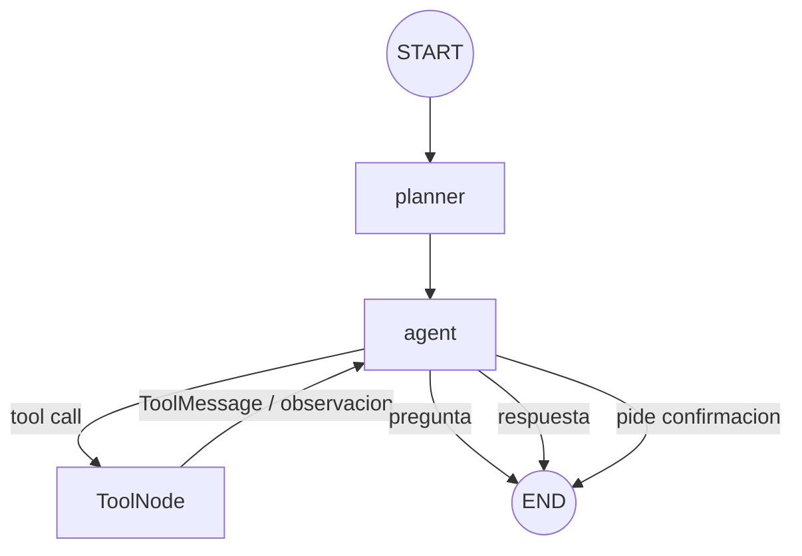

# Ragzor EP2: agente de Mesa de Ayuda TI

Esta guia explica la EP2 en el mismo orden en que conviene presentarla. La idea
central es sencilla: **Ragzor sigue usando el RAG de la EP1, pero LangGraph le
permite decidir cuando usarlo y que hacer con el resultado.**

## 1. Resumen para exponer

```text
React
  → POST /api/chat
FastAPI
  → invoca LangGraph con thread_id y user_id
planner
  → crea un plan validado de 2 a 4 pasos
agent
  → elige responder, preguntar, confirmar o usar una tool
ToolNode
  → ejecuta buscar_documentacion / consultar_ticket / crear_ticket
agent
  → observa el resultado y decide el siguiente paso
```

Existe un solo agente. No hay multiagentes, evaluador, replanner, servicios
externos ni una segunda base vectorial.

## 2. Que aporta LangGraph

LangGraph permite modelar la conversacion como un grafo con estado. En
`backend/app/agent/graph.py`, `StateGraph` conecta tres nodos:

- `planner`: pide al LLM un `Plan` y Pydantic valida que tenga 2 a 4 pasos.
- `agent`: observa conversacion, plan, memoria y resultados; elige una accion.
- `tools`: `ToolNode` ejecuta una de las tres tools y devuelve una observacion.



El edge `tools → agent` es importante: implementa el ciclo tipo ReAct sin
mostrar Chain-of-Thought. Solo se expone actividad observable, por ejemplo
"Consulto documentacion".

## 3. Estado

`AgentState` contiene:

| Campo | Uso |
|---|---|
| `messages` | conversacion y observaciones de tools |
| `user_id` | separa tickets y memoria por usuario |
| `thread_id` | vincula la conversacion y las acciones pendientes |
| `plan` | plan visible de 2 a 4 pasos |
| `sources` | evidencia recuperada por FAISS |
| `pending_action` | ticket preparado, aun no escrito |
| `final_answer` | respuesta que FastAPI devuelve |
| `activity` | acciones externas visibles |
| `confirmation` | `confirm`, `cancel` o vacio |

`messages` usa `add_messages`, reducer de LangGraph que agrega nuevos mensajes
sin perder el historial del thread.

## 4. Planner y decision del agente

Ollama se mantiene con `llama3:latest`. El cliente original del proyecto no
exponia tool calling nativo y no se cambio de modelo. En su lugar:

1. Ollama recibe un JSON Schema con `format`.
2. `structured_chat` parsea el JSON.
3. Pydantic valida `Plan` o `AgentDecision`.
4. El nodo `agent` transforma la accion validada en un tool call para
   `ToolNode`.

Esto separa la decision del LLM de la ejecucion y evita ejecutar texto libre.
Las posibles decisiones son `respond`, `search_documentation`,
`consult_ticket`, `ask_user` y `request_confirmation`.

## 5. Las tools

### buscar_documentacion

Reutiliza directamente `retrieve()` de la EP1:

```text
query → bge-m3 → FAISS → top 2 chunks → contenido + metadata
```

No se duplicaron carga, chunking, embeddings ni indice. Los resultados pasan a
`sources` para conservar "Ver evidencia".

### consultar_ticket

Busca en `tickets` por `ticket_id` o `user_id`. No contiene SQL de escritura.

### crear_ticket

Recibe solo `action_id`, `thread_id` y `user_id`. SQLite recupera el
resumen y detalle congelados en `pending_actions`, comprueba propietario,
estado y expiracion, crea el ticket y consume la accion en una transaccion
`BEGIN IMMEDIATE`. Un reintento devuelve el mismo ticket sin duplicarlo.

## 6. Memoria corta

El grafo se compila con `MemorySaver`. Internamente usa
`user_id:thread_id` como clave del checkpointer. Por eso:

```text
Thread A: "Necesito acceso a produccion"
Thread A: "Dos semanas"
```

conserva el primer mensaje, aunque React no reenvie un array `history`. El boton
de nueva conversacion genera otro `thread_id`.

`MemorySaver` es suficiente para la demostracion; al reiniciar el backend se
reinician los threads. Los datos entre conversaciones que deben persistir se
guardan aparte en SQLite.

## 7. Memoria larga

`ragzor.db` tiene dos tablas de dominio y una tabla de control:

```sql
tickets(id, user_id, summary, details, status, created_at)
memory(id, user_id, key, value, updated_at)
pending_actions(id, thread_id, user_id, action_type, summary, details,
                status, created_at, expires_at, ticket_id)
```

No hay embeddings de memoria. Ante "¿Cual fue mi ultima solicitud?", el agente
ve `last_ticket_id`, ejecuta `consultar_ticket` y responde desde el registro.
Ante "mis solicitudes" consulta hasta diez tickets recientes. La recuperacion
semantica demostrada sigue siendo el RAG documental FAISS.

## 8. Confirmacion de escritura

El flujo seguro es:

1. El agente comprueba que tiene antecedentes suficientes.
2. Persiste `pending_action` con UUID, resumen, detalle, propietario y TTL.
3. Devuelve `needs_confirmation=true`.
4. React muestra **Confirmar ticket** y **Cancelar**.
5. Solo `confirmation=confirm` para el mismo usuario y thread genera el call a
   `crear_ticket`; el backend no confia en un booleano aislado.
6. La tool vuelve al agente, que observa el ID y responde "Ticket #N creado".

Cancelar invalida la accion pendiente. Reemplazarla cancela la anterior.
Confirmar sin accion, luego de expirar, desde otro usuario/thread o despues de
cancelar no crea nada. El doble clic es idempotente.

## 9. Replanificacion

El planner se ejecuta en cada turno. Si el plan cambia, `activity` informa
"Actualizo el plan ante la nueva informacion". Marcadores como "en realidad",
"ya no" o un cambio de produccion a pruebas permiten una nueva busqueda
documental en vez de reutilizar la observacion anterior.

## 10. Conversacion de demostracion

```text
Usuario: Necesito acceso administrador al servidor de produccion por dos semanas.
Ragzor: [consulta documentacion] ¿Cual es el servidor exacto, la justificacion,
        la ventana de uso y el cambio autorizado?

Usuario: srv-pagos-01, por el incidente INC-200, hoy de 18:00 a 20:00;
         cambio CHG-44 y reversa retirando el rol.
Ragzor: Tengo los antecedentes necesarios. ¿Deseas que cree el ticket?

Usuario pulsa: Confirmar ticket
Ragzor: Ticket #15 creado correctamente. Estado: open.

[Nueva conversacion, mismo user_id]
Usuario: ¿Cual fue mi ultima solicitud?
Ragzor: [consulta SQLite] Tu ultima solicitud fue acceso temporal a produccion,
        registrada en el ticket #15.
```

## 11. API y ejecucion

La entrada normal es:

```json
{"message":"Hola","thread_id":"thread-1","user_id":"ana"}
```

La respuesta incluye `answer`, `thread_id`, `plan`, `sources`,
`needs_confirmation`, `pending_action` y `activity`. El campo antiguo `history`
se acepta temporalmente por compatibilidad, pero el agente no depende de el.

```bash
python scripts/ingest.py
python scripts/seed_database.py
uvicorn app.main:app --app-dir backend --reload
npm --prefix frontend run dev
```

## 12. Pruebas clave

`backend/tests/test_agent.py` valida que:

- el grafo compila;
- la tool documental reutiliza el retriever;
- el mismo thread conserva turnos anteriores;
- no se escribe antes de confirmar;
- el ticket y la memoria larga persisten;
- la ultima solicitud puede recuperarse.
- un ID de ticket no cruza propietarios;
- confirmar dos veces no duplica;
- cancelar, expirar o reemplazar invalida;
- dos usuarios con el mismo thread visible no mezclan mensajes;
- un cambio de objetivo vuelve a planificar y buscar evidencia.

## 13. Limites defendibles

La identidad es simulada porque `user_id` proviene de React; en produccion
debe derivarse de una sesion autenticada. `MemorySaver` no sobrevive
reinicios. `memory` y `tickets` aportan persistencia relacional, no busqueda
semantica. Ollama y FAISS son dependencias locales para los smoke tests.

`backend/tests/test_api.py` valida el contrato HTTP, evidencia, errores de Ollama
y que un saludo no activa tools.
